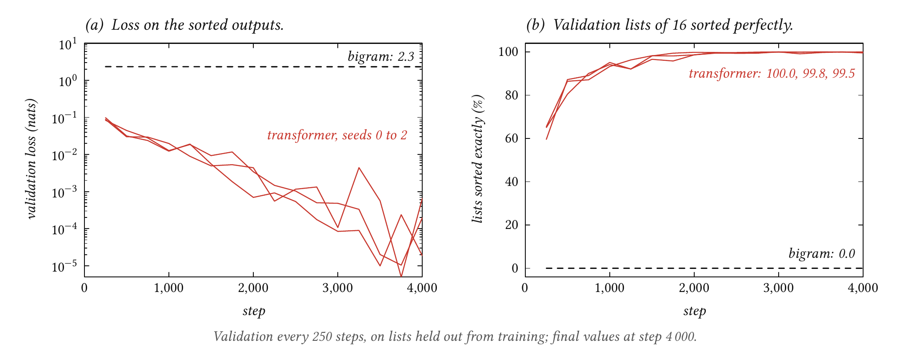
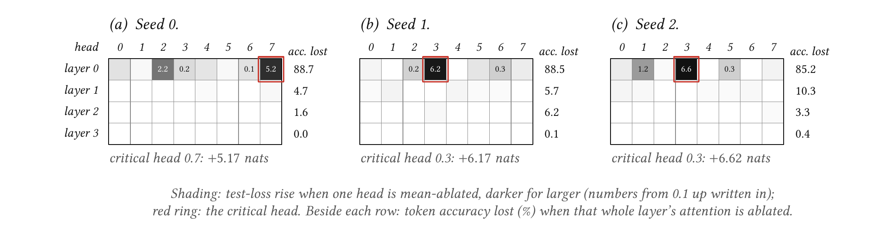
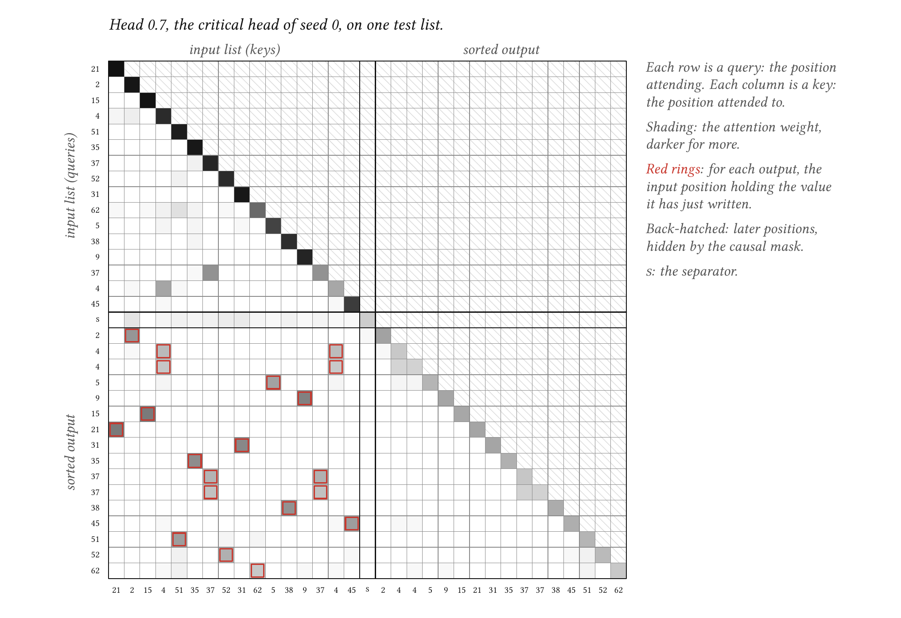

# tiny-transformer

**A GPT-style transformer from scratch.** A readable, hookable GPT-style decoder-only transformer that blindfold-tfm, deja-vu-tfm and tiny-trace-tfm install and build on.

**Status:** done.

A GPT-style decoder-only transformer, packaged so other repos can install it. It follows the GPT-2 architecture as Karpathy's "Let's build GPT" video and nanoGPT write it, with every internal activation named so it can be read and overwritten.

## Goal

One readable, hookable backbone that trains on any integer token sequences: maze traces, game moves, text.

## Results

**The backbone learns to sort.** The default model (3.2M parameters, 4 layers) sorts 99.8–100% of 2,048 held-out lists of 16 values perfectly across three seeds. A bigram model trained the same way sorts none.

| Model (test set, 2,048 lists) | Loss (nats) | Token accuracy | Lists sorted exactly |
| --- | --- | --- | --- |
| Untrained, same architecture (seeds 0–2) | 4.21–4.23 | 1.4–1.8% | 0% |
| Bigram: `--model.n-layers 0` (seed 0 only) | 2.32 | 20.0% | 0% |
| Default, seed 0 | 0.000004 | 100% | 100% |
| Default, seed 1 | 0.00001 | 100% | 100% |
| Default, seed 2 | 0.0005 | 99.98% | 99.8% |

Chance token accuracy is 1/64 (1.6%). The bigram model sees only the previous output, so it learns that the next value is usually a bit larger, and no more.



*__Every seed sorts more than 98% of validation lists perfectly from step 2,000 on; the bigram model sorts none.__ Runs `default-seed0` to `default-seed2` and `bigram-seed0`. Validation loss falls by four orders of magnitude, to between 2 × 10⁻⁵ and 7 × 10⁻⁴ nats at step 4,000, while the bigram model stays at 2.3. All three seeds first reach 100% on validation between steps 3,000 and 3,500.*

**Almost all of the attention work happens in one layer-0 head.** Mean-ablating each head in turn (replacing its output with its average, taken from validation lists) shows one head per seed the model cannot do without. Removing it raises test loss by 5.2–6.6 nats and wipes out 76–81% of token accuracy. Removing any single head in layers 1–3 changes the loss by at most 0.02 nats.



*__In every seed one layer-0 head carries the model; layers 1 to 3 barely matter.__ Runs `default-seed0` to `default-seed2`. Each cell is one head, shaded by how much mean-ablating it raises test loss; the critical head is ringed (0.7 in seed 0, 0.3 in seeds 1 and 2). The numbers beside each row are the token accuracy lost when that layer's attention is ablated whole, as in the table below.*

That head does one clear thing: **from each output position it attends to the input copy of the value just written**. Its strongest attention lands there on 98.6–99.5% of outputs across the three seeds, against 7.7% for a random input position.



*__Each output attends to the input copy of the value it has just written.__ Run `default-seed0`, head 0.7, on the first test list. Rows are the positions attending, columns the positions attended to, and shading is the attention weight. The red rings mark, for each output, the input positions holding the value just written (both copies when a value repeats); on this list, all 16 outputs put their strongest attention on a ringed cell.*

| Ablation, test set | Seed 0 | Seed 1 | Seed 2 |
| --- | --- | --- | --- |
| All of layer 0's attention: token accuracy lost | 88.7% | 88.5% | 85.2% |
| All of layer 1's attention | 4.7% | 5.7% | 10.3% |
| All of layer 2's attention | 1.6% | 6.2% | 3.3% |
| All of layer 3's attention | 0.0% | 0.1% | 0.4% |
| Identity patch (control): largest logit change | 0 | 0 | 0 |

**Negative result: attention to the next value is visible but barely used.** The intuitive mechanism for sorting is a head that looks up the next value to write. Heads like that exist: in layer 2, one head's strongest attention lands on the next value 61–67% of the time (chance 7.7%). But ablating the whole of layer 2's attention costs only 1.6–6.2% of token accuracy, so the model does not rely on them. A pattern you can read off the attention is not evidence the model uses it.

**Open question.** How the model gets from "where is the value I just wrote" to "what comes next" is not established here. The MLPs and the residual stream after layer 0 are untested, and so is whether the critical head also tracks repeated values. This is the kind of question the probing repos are for.

## Using it from another repo

Install it as a git dependency (`tiny-transformer = { git = 'https://github.com/coeiico/tiny-transformer' }` under `[tool.uv.sources]`), then:

```python
import torch
from tiny_transformer.config import TransformerConfig
from tiny_transformer.generate import generate
from tiny_transformer.hub import load_model, save_model
from tiny_transformer.model import Transformer
from tiny_transformer.modes import evaluating
from tiny_transformer.objective import next_token_loss

model = Transformer(TransformerConfig(vocab_size=64, max_seq_len=128))
loss = next_token_loss(model(tokens), tokens, loss_mask)  # loss_mask marks the tokens worth learning

with evaluating(model):                                   # eval mode, no gradients, modes restored after
  logits, cache = model(tokens, return_cache=True)        # cache['blocks.2.resid_post'], ...
  patched = model(tokens, patch={'blocks.1.attn.z': lambda z: z * 0})

moves = generate(model, prompt, max_new_tokens=20, legal=legal_moves)  # legal: tokens -> bool [batch, vocab]
save_model(run_dir, model, vocab)                         # weights + architecture + vocabulary
model, vocab = load_model(run_dir)                        # strict: mismatched weights are an error
```

The hook names and shapes are listed in the docstring at the top of [`model.py`](src/tiny_transformer/model.py). Task-specific data, rules and metrics stay in the downstream repo; this package never needs to know what the tokens mean.

## How it works

The owner knows autograd, optimizers and the MLP block. This is what sits on top.

- **Embeddings.** Each token id looks up a learned vector of width `d_model`, and each position looks up another (learned absolute positions, as in GPT-2). Their sum starts the **residual stream**: one vector per position that every layer reads from and adds to.
- **Causal self-attention.** At each position, a head forms a *query* ("what am I looking for?") and compares it with every earlier position's *key* ("what do I hold?") by dot product. A softmax turns those scores into weights, and the head returns the weighted sum of the earlier positions' *values*. Scores for later positions are set to −∞ before the softmax, so a position can never see the future: that is what lets one forward pass train every next-token prediction in a sequence at once. Several heads run side by side, each free to look for something different, and an output matrix `W_O` mixes their results back into the stream.
- **Pre-norm blocks.** Each block normalises a copy of the stream, runs attention on it and adds the result back, then does the same with the MLP. The stream itself is only ever added to, so gradients reach early layers through the additions. GPT-2 also shrinks the initial weights that write into the stream by 1/√(2 · layers), so the stream does not grow with depth at the start of training.
- **Next-token loss with a mask.** Position *t*'s logits predict token *t* + 1. A loss mask marks which tokens are worth predicting: here the sorted output, not the random input. A batch with no marked tokens raises an error instead of reporting a misleading zero loss. Right padding needs nothing more than marking pads as not targets, because causal attention means real positions never see the pads after them.
- **Hooks and patching.** Every intermediate activation has a name (`blocks.1.attn.pattern`, `blocks.2.mlp.post`, ...). `return_cache=True` returns them all; `patch` replaces any of them mid-forward with a tensor or a function. Reading activations is how probes find what a model represents; patching them is how interventions test whether the model uses it.
- **Mean ablation.** To ask what one attention head contributes, replace its output with its average output over many inputs. The head still adds its typical offset to the stream, but carries no information about this particular input. The rise in loss measures how much the model relied on it.
- **Optimisation.** AdamW with weight decay on matrices and embeddings only, gradient clipping at norm 1, and a learning rate that warms up linearly for 100 steps, then follows a cosine down to 10% of its peak (nanoGPT's schedule).

## Experiment

The backbone needs a task to show it works. This repo's demo is **sorting**: 16 values from 0–63, a separator, then the same values sorted. Only the sorted half is a target. Sorting needs attention (each output has to find the right input), has an exact answer, and leaves room for a clear mechanism to find.

- **Splits.** The split unit is the input list. 1,024 validation and 2,048 test lists are fixed by their own seeds and shared by every run; training draws fresh lists each step from the run's seed and skips any held-out list.
- **Metrics.** Token accuracy (each output token, given the true tokens before it) and exact match (the model writes all 16 outputs itself, greedily, and every one must be right).
- **Baselines.** An untrained model with the same architecture, and a bigram model (`--model.n-layers 0`: embed, then unembed, so each prediction sees only the previous token) trained the same way.
- **Analysis.** Mean ablation of every head on the test set (averages taken from validation, so nothing is fitted on test), with an identity patch as the control, and a lookup score per head.

## Tests

`just test` runs 55 CPU tests in a few seconds:

- Shapes, the documented cache shapes, and the default size (about 3M parameters).
- Causality: changing a token never changes earlier logits.
- Next-token alignment, loss masking and right padding, checked against hand-computed values, including a batch with no targets.
- Cached and plain forward passes give identical logits; identity patches (functions and tensors) preserve outputs; unknown names and wrong shapes are rejected; cached activations carry gradients.
- Every parameter receives a finite, non-zero gradient across norm and MLP choices, and a tiny model overfits a tiny batch.
- Save and load preserves predictions, config and vocabulary, and loading into a different architecture fails.
- `evaluating()` restores each submodule's mode, including deliberately frozen ones, even after an error; generation respects legal-token masks and restores the training mode.
- The sorting task's layout, determinism and split separation.

## Done when

The general checklist:

Apply this checklist with the project-specific requirements and exceptions in
[CLAUDE.md](CLAUDE.md#project-specific-scope).

- `just quick` runs end to end on CPU in under 5 minutes, as a smoke test.
- The full run fits on one consumer GPU (8–12 GB VRAM) and auto-detects cuda, mps or cpu.
- Each run saves weights, `metrics.json` and its plots to `runs/<run-name>/`.
- This README shows the headline result with plots, compares against baselines, and states negative results plainly.
- Tests cover data generators, tensor shapes and one tiny overfit check.

## Notes

- **Optional, not done:** a converter to TransformerLens's `HookedTransformer`, to borrow its analysis tools. The hook names follow TransformerLens's style closely enough that one would be short.
- The README figures are drawn in LaTeX from the files in `figures/data/`, copied from `runs/<run>/analysis/figures/figure-data/` for the runs each caption names (`.agents/instructions/figure-design.md` says how). Building them needs LuaLaTeX, the Libertinus fonts and `pdftoppm`; the PNGs are committed.
- **Hugging Face.** The four runs in this README (`default-seed0` to `default-seed2` and `bigram-seed0`), with weights, `model_config.json`, `metrics.json`, plots and their analysis, are at [coeiico/tiny-transformer](https://huggingface.co/coeiico/tiny-transformer), one folder per run, so they can be loaded without training (`tiny_transformer.hub.load_model`). `just push <run>` uploads one run.
- **Data.** There is no dataset to download: the sorting lists are generated from the task settings and seeds, recorded in each run's `metrics.json`.
- Runs save evaluation weights only, not resumable checkpoints: a full run takes about 3 minutes, so restarting is cheaper than resuming.
- Other repos install this as a git dependency. While developing both at once, point them at the local folder with `uv add --editable ../tiny-transformer`, then switch back to the git source before committing.

## Quickstart

Needs [uv](https://docs.astral.sh/uv/) and [just](https://just.systems/). Everything else, Python 3.12 included, comes from uv.

```sh
just setup                                # uv sync, then install the pre-commit hooks
just quick                                # CPU smoke test, a few seconds
just train --run-name default-seed0       # full run, about 3.5 minutes on an RTX 3060
just bg train ...                         # the same, in a detached tmux session; any recipe works
just train --run-name bigram-seed0 --model.n-layers 0
just analyze default-seed0 --name final   # baselines, head ablations, attention plots
just figures                              # rebuild the README figures (LaTeX) from figures/data/
just predict default-seed0 --values 5 3 9 ...
just test                                 # pytest
just check                                # ruff and basedpyright, as in CI
```

Copy `.env.example` to `.env` (gitignored) for `HF_TOKEN` and `HF_USER`.

## Layout

```
tiny-transformer/
├── README.md                goal, results with plots, how it works
├── CLAUDE.md                instructions for coding agents; AGENTS.md points here
├── .agents/                 instructions/ and plans/
├── pyproject.toml, uv.lock, .python-version, justfile, .pre-commit-config.yaml, .github/
├── src/tiny_transformer/
│   ├── config.py            TransformerConfig
│   ├── model.py             the transformer and its hook points
│   ├── objective.py         next-token loss with masking
│   ├── modes.py             evaluating(): eval mode that restores itself
│   ├── generate.py          greedy and sampled generation, legal-token masks
│   ├── hub.py               save and load weights with config and vocabulary
│   ├── sorting.py           the demo task (not part of the backbone)
│   └── utils.py             run bookkeeping
├── train.py                 CLI; --quick runs the CPU smoke test
├── predict.py               sort a list with a trained run
├── analyze.py               baselines, head ablations, attention plots
├── figures/                 README figures: LaTeX sources, the data they read, built PNGs
├── notebooks/               marimo notebooks for exploration
├── tests/
└── runs/                    outputs, gitignored
```

## Sources

- Andrej Karpathy, [nanoGPT](https://github.com/karpathy/nanoGPT) and "Let's build GPT: from scratch, in code, spelled out" (2023).
- Radford et al., "Language Models are Unsupervised Multitask Learners" (GPT-2, 2019).
- Vaswani et al., "Attention Is All You Need" (2017).
- Neel Nanda, [TransformerLens](https://github.com/TransformerLensOrg/TransformerLens), whose hook naming this follows.

## License

MIT
